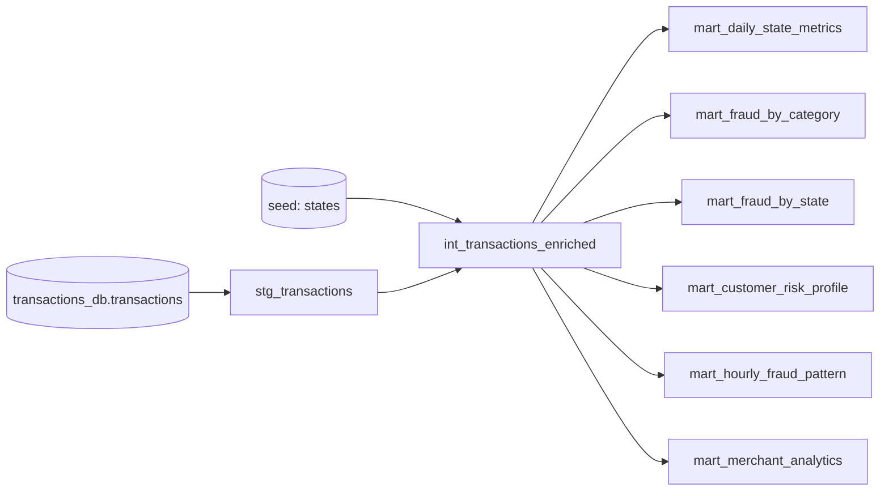
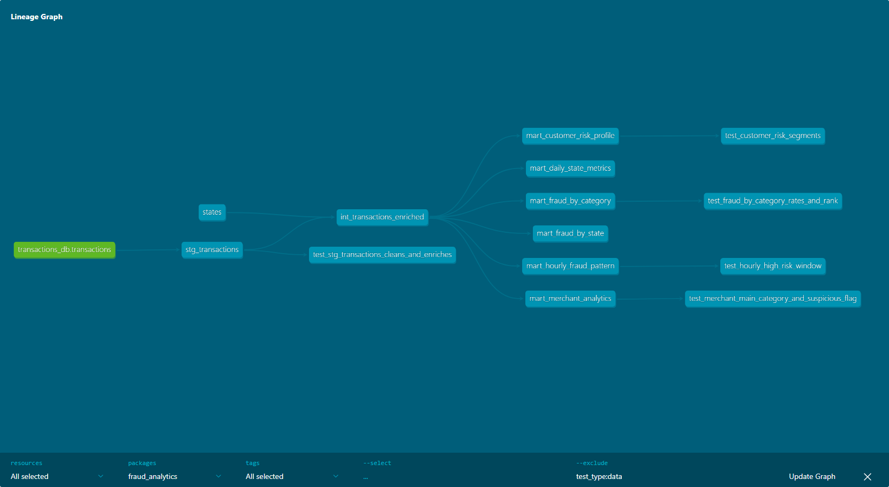
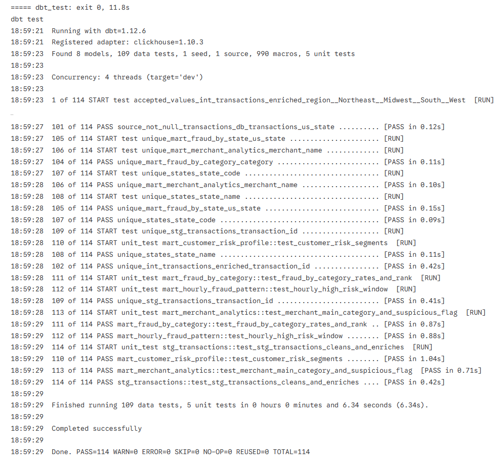

# Антифрод-аналитика на dbt и ClickHouse

dbt-проект поверх таблицы `transactions_db.transactions` из домашки по ClickHouse: карточные транзакции с признаком фрода (датасет Sparkov, колонки переименованы как в соревновании teta-ml-1-2025). Сырые данные проходят слои source → staging → intermediate → marts, на выходе шесть аналитических витрин, документация dbt Docs и тесты трёх видов: generic, singular и unit.

| Что | Версия |
|-----|--------|
| dbt-core | 1.12.6 |
| dbt-clickhouse | 1.10.3 |
| ClickHouse | 26.8 LTS |
| dbt_utils / dbt_date / dbt_expectations | 1.4.1 / 0.21.0 / 0.10.10 |
| sqlfluff | 4.5.0 |
| pre-commit | 4.7.0 |
| Python | 3.11+ (pre-commit 4.7 требует 3.11) |

---

## Быстрый старт

```bash
cd dbt/
pip install -r requirements.txt

# ClickHouse: либо сервер из домашки по ClickHouse, либо локальный из docker-compose.yml
docker compose up -d --wait

# таблица transactions_db.transactions, если её ещё нет (train.csv соревнования или fraudTrain.csv Sparkov)
python scripts/load_transactions.py --csv data/train.csv --recreate

dbt deps && dbt seed && dbt run && dbt test
dbt docs generate && dbt docs serve
```

То же через Makefile: `make install`, `make clickhouse-up`, `make load-data CSV=data/train.csv`, `make all`, `make docs-serve`. Полный список целей выводит `make help`.

Подключение задаётся переменными окружения, по умолчанию локальный ClickHouse без пароля:

| Переменная | По умолчанию |
|------------|--------------|
| `CLICKHOUSE_HOST` | `localhost` |
| `CLICKHOUSE_PORT` | `8123` |
| `CLICKHOUSE_USER` | `default` |
| `CLICKHOUSE_PASSWORD` | пусто |
| `DBT_CLICKHOUSE_SCHEMA` | `fraud_dbt` |

`profiles.yml` лежит в папке проекта, dbt находит его сам, отдельный `~/.dbt/profiles.yml` не нужен. Если сырая таблица лежит в другой базе, её имя передаётся переменной: `dbt run --vars '{source_schema: my_db}'`.

---

## Слои и граф зависимостей



| Слой | Модель | Материализация | База ClickHouse |
|------|--------|----------------|-----------------|
| source | `transactions_db.transactions` | сырая таблица | `transactions_db` |
| seeds | `states` — 50 штатов и DC с регионом и дивизионом Census Bureau | таблица | `fraud_dbt_seeds` |
| staging | `stg_transactions` | таблица MergeTree | `fraud_dbt_staging` |
| intermediate | `int_transactions_enriched` | view | `fraud_dbt_intermediate` |
| marts | шесть витрин `mart_*` | таблицы MergeTree | `fraud_dbt_marts` |

В ClickHouse схема dbt соответствует базе данных, поэтому каждый слой лежит в своей базе с префиксом из профиля.

**stg_transactions.** Переименовывает сырые колонки и приводит типы, снимает технический префикс `fraud_` с названий мерчантов, нормализует регистр категории, пола и штата. Строит суррогатные ключи транзакции и клиента через `dbt_utils.generate_surrogate_key`: номера карты в таблице нет, клиент определяется по имени, полу и координатам домашнего адреса (на Sparkov это один к одному совпадает с номером карты). Удаляет полные дубликаты. Добавляет вычисляемые поля: дату, час, ISO-день недели и его название (`dbt_date.day_of_week`, `dbt_date.day_name`), часть суток, корзину суммы (макрос `amount_bucket`), флаг крупной суммы и расстояние до мерчанта (макрос `haversine_distance_km`). Материализуется таблицей, чтобы md5-ключи и дедупликация считались один раз, а не в каждой витрине.

**int_transactions_enriched.** Присоединяет к транзакциям справочник штатов из seed: название, регион, дивизион. Это общий вход для всех витрин.

### Витрины

| Витрина | Грань | Основные метрики |
|---------|-------|------------------|
| `mart_daily_state_metrics` | дата × штат | число транзакций, сумма, средний чек, медиана, P95, максимум, доля крупных транзакций, fraud_rate |
| `mart_fraud_by_category` | категория | транзакции и фроды, fraud_rate, суммы, доля фродовых денег, доля категории во всём фроде, ранг |
| `mart_fraud_by_state` | штат | fraud_rate, уникальные клиенты и мерчанты, сколько из них затронуто фродом, суммы, ранг |
| `mart_customer_risk_profile` | клиент | история (первая и последняя транзакция, активные дни, категории, мерчанты), средний чек, доля ночных и крупных операций, fraud_rate, сегмент HIGH / MEDIUM / LOW |
| `mart_hourly_fraud_pattern` | день недели × час | fraud_rate окна, общий fraud_rate, lift, флаг рискованного окна, ранг |
| `mart_merchant_analytics` | мерчант | основная категория, оборот, средний чек, клиенты, fraud_rate, lift, флаг подозрительности, ранг по обороту |

`fraud_rate` во всех витринах в процентах, от 0 до 100. Пороги для сегментов и флагов вынесены в `vars` в `dbt_project.yml`:

| Переменная | Значение | Где используется |
|------------|----------|------------------|
| `amount_bucket_thresholds` | `[10, 50, 200, 1000]` | границы корзин micro / small / medium / large / very_large |
| `large_amount_threshold` | 200 | крупная транзакция для доли крупных в дневной витрине |
| `high_risk_fraud_rate_pct` | 2.0 | клиент HIGH при fraud_rate не ниже порога, MEDIUM при любом фроде ниже порога, LOW без фрода |
| `high_risk_window_lift` | 2.0 | окно день × час рискованное, если fraud_rate выше общего в 2 раза и больше |
| `suspicious_merchant_lift`, `suspicious_merchant_min_fraud_txn` | 2.0, 5 | мерчант подозрительный при fraud_rate выше общего в 2 раза и хотя бы 5 фродах |

---

## Макросы

| Макрос | Что делает | Где используется |
|--------|-----------|------------------|
| `amount_bucket(column, thresholds)` | CASE по корзинам суммы, границы из `var('amount_bucket_thresholds')`, проверяет, что границ четыре и они возрастают | `stg_transactions` |
| `safe_pct(numerator, denominator, precision)` | доля в процентах с округлением, при нулевом знаменателе 0 | все витрины |
| `percentile(column, quantile)` | перцентиль через `adapter.dispatch`: `quantileExact(q)(x)` в ClickHouse, `percentile_cont` в остальных базах | `mart_daily_state_metrics` |
| `haversine_distance_km(lat1, lon1, lat2, lon2)` | расстояние по большому кругу в километрах | `stg_transactions` |

Описания макросов и аргументов лежат в `macros/macros.yml` и видны в dbt Docs.

## Пакеты

| Пакет | Что используется |
|-------|------------------|
| `dbt-labs/dbt_utils` | `generate_surrogate_key` в staging; тесты `unique_combination_of_columns`, `expression_is_true`, `accepted_range`, `equal_rowcount` |
| `godatadriven/dbt_date` | `day_of_week`, `day_name`, `date_part` в staging, у пакета есть реализации под ClickHouse |
| `metaplane/dbt_expectations` | тесты `expect_column_values_to_be_between`, `expect_table_row_count_to_be_between`, `expect_table_row_count_to_equal`, `expect_compound_columns_to_be_unique`, `expect_column_pair_values_A_to_be_greater_than_B`, `expect_column_mean_to_be_between`, `expect_column_distinct_count_to_equal` |

Версии зафиксированы в `package-lock.yml`.

---

## Тесты

**Generic-тесты в yml.** `not_null`, `unique`, `accepted_values`, `relationships` на источнике, staging, intermediate, seed и витринах. Уникальность составных ключей витрин: `dbt_utils.unique_combination_of_columns` для (дата, штат) и `dbt_expectations.expect_compound_columns_to_be_unique` для (день недели, час). Диапазоны процентов, часов и дней недели через `dbt_expectations`, логические связи колонок через `dbt_utils.expression_is_true`. Два теста с `severity: warn` проверяют здравый смысл данных: средняя доля фрода в staging не выше 5 процентов и в профиле клиентов есть все три сегмента.

**Singular-тесты в `tests/`.**

| Тест | Что проверяет |
|------|---------------|
| `assert_no_negative_amounts` | в staging нет отрицательных сумм |
| `assert_fraud_rate_bounds` | fraud_rate во всех шести витринах от 0 до 100 |
| `assert_marts_reconcile_with_staging` | каждая витрина в сумме даёт ровно столько транзакций, фродов и фродовых денег, сколько staging, то есть ничего не потеряно и не задвоено |
| `assert_p95_within_median_and_max` | P95 за день в штате лежит между медианой и максимумом |
| `assert_risk_segment_matches_fraud_history` | сегмент клиента согласован с его фродом и порогом |

**Unit-тесты (dbt 1.8+).** Проверяют логику моделей на маленьких фикстурах без реальных данных:

| Тест | Модель | Что проверяет |
|------|--------|---------------|
| `test_stg_transactions_cleans_and_enriches` | `stg_transactions` | снятие префикса мерчанта, регистр, корзины `amount_bucket`, флаг крупной суммы, час, ISO-день недели, часть суток, удаление дубликата |
| `test_fraud_by_category_rates_and_rank` | `mart_fraud_by_category` | fraud_rate, доли и ранг категорий |
| `test_customer_risk_segments` | `mart_customer_risk_profile` | сегменты HIGH / MEDIUM / LOW с переопределённым порогом |
| `test_hourly_high_risk_window` | `mart_hourly_fraud_pattern` | lift и флаг рискованного окна |
| `test_merchant_main_category_and_suspicious_flag` | `mart_merchant_analytics` | основная категория мерчанта и флаг подозрительности |

```bash
dbt test                                # все тесты
dbt test --select "test_type:unit"      # только unit
dbt test --select "test_type:data"      # только generic и singular
```

---

## Документация

```bash
dbt docs generate
dbt docs serve
```

Описания моделей, колонок, источника и макросов лежат в yml, общие определения (fraud_rate, сегмент риска, корзины суммы, флаги) вынесены в doc-блоки `models/docs.md`, там же главная страница документации. Описания таблиц и колонок дополнительно записываются комментариями в ClickHouse (`persist_docs`), их видно в `system.columns` и в любом SQL-клиенте.



Тот же граф вместе с singular-тестами: [assets/dbt_docs_dag_full.png](assets/dbt_docs_dag_full.png), страница витрины и главная страница документации: [assets/dbt_docs_model.png](assets/dbt_docs_model.png), [assets/dbt_docs_overview.png](assets/dbt_docs_overview.png).

---

## Проверка на данных

Docker на машине разработки нет, поэтому полный цикл прогонялся на Kaggle (Linux): ClickHouse 26.8.36.3 ставился официальным бинарником, в `transactions_db.transactions` загружался `fraudTrain.csv` датасета Sparkov (1 296 675 транзакций, 7 506 фродов, 51 штат с DC, 14 категорий), дальше команды из `Makefile`.

| Команда | Результат |
|---------|-----------|
| `make seed` | PASS=1 |
| `make run` | PASS=8 (7 таблиц, 1 view) |
| `make test` | PASS=114 WARN=0 ERROR=0 (109 тестов данных, 5 unit-тестов) |
| `make docs` | каталог и документация собраны |
| `make lint` | нарушений нет |
| `make pre-commit` | все 6 хуков Passed, файлы не изменены |



Полный вывод `dbt test` лежит в [assets/dbt_test.log](assets/dbt_test.log), весь прогон с выборками из витрин — в [assets/kaggle_run.log](assets/kaggle_run.log).

Что видно в витринах. Средний fraud_rate 0,58 %, выше всего в `shopping_net` (1,76 %), `misc_net` (1,45 %) и `grocery_pos` (1,41 %). Рискованные окна — 22 и 23 часа во все дни недели (fraud_rate в 5 раз выше среднего) и почти все окна с 0 до 3 часов (в 2,5–2,9 раза выше). Мошенничество тяготеет к крупным суммам: в корзине `large` fraud_rate 8,2 %, в `very_large` 24,1 %, в остальных корзинах 0,04–0,32 %. Сегменты клиентов: 141 HIGH, 621 MEDIUM, 221 LOW; подозрительными отмечены 130 из 693 мерчантов. Штаты с одним-двумя клиентами дают шумный fraud_rate (в DE единственный клиент с 9 транзакциями, все мошеннические), поэтому в `mart_fraud_by_state` рядом с fraud_rate лежат число клиентов и транзакций.

---

## Линтинг и pre-commit

`sqlfluff` с диалектом `clickhouse`, настройки в `.sqlfluff`. Шаблонизатор jinja, а не dbt: dbt-шаблонизатору нужно живое подключение к ClickHouse, а хуки должны работать на машине без базы. Чтобы jinja-шаблонизатор понимал dbt, включены `apply_dbt_builtins` (ref, source, config), макросы проекта подгружаются из `macros/`, а `sqlfluff_libs/` подменяет остальное: `var()` читает настоящие значения из `dbt_project.yml`, пакетные макросы `dbt_utils` и `dbt_date` рендерятся в простые SQL-выражения. Отключены правила регистра функций и типов (CP03, CP05), потому что в ClickHouse `countIf`, `argMax`, `quantileExact`, `DateTime` чувствительны к регистру, и правило порядка колонок ST06.

```bash
sqlfluff lint models tests      # или make lint
sqlfluff fix models tests       # или make fix
```

`.pre-commit-config.yaml` запускает `sqlfluff-fix` и `sqlfluff-lint` для SQL моделей и тестов, а также базовые хуки (пробелы в конце строк, перевод строки в конце файла, валидность yaml, крупные файлы). Конфиг лежит в `dbt/`, а хуки запускаются из корня git-репозитория:

```bash
pre-commit install --config dbt/.pre-commit-config.yaml
pre-commit run --config dbt/.pre-commit-config.yaml --all-files
```

Из папки `dbt/` то же самое делают `make pre-commit-install` и `make pre-commit`.

---

## Структура

```
dbt/
├── dbt_project.yml              # слои, материализации, vars
├── packages.yml / package-lock.yml
├── profiles.yml                 # подключение к ClickHouse через переменные окружения
├── requirements.txt
├── Makefile
├── docker-compose.yml           # ClickHouse 26.8 для локального запуска
├── .sqlfluff / .sqlfluffignore
├── .pre-commit-config.yaml
├── models/
│   ├── docs.md                  # doc-блоки и главная страница dbt Docs
│   ├── sources/sources.yml
│   ├── staging/stg_transactions.sql, stg_transactions.yml (+ unit-тест)
│   ├── intermediate/int_transactions_enriched.sql, .yml
│   └── marts/                   # шесть витрин, schema.yml, unit_tests.yml
├── macros/                      # amount_bucket, safe_pct, percentile, haversine_distance_km, macros.yml
├── seeds/states.csv, seeds.yml
├── tests/                       # singular-тесты
├── scripts/load_transactions.py # создание и загрузка transactions_db.transactions
├── sqlfluff_libs/               # заглушки dbt для линтинга без базы
└── assets/                      # скриншоты и лог dbt test для PR
```
